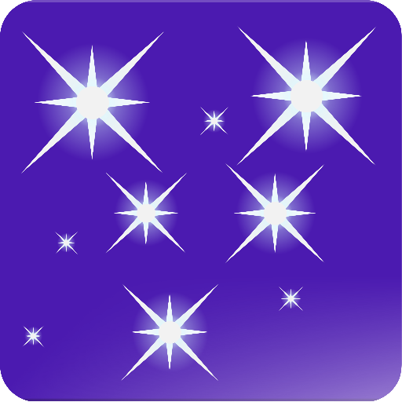

<p align="center">
  
</p>

<h1 align="center">Vela Components</h1>

<p align="center">
  <strong>React components and an NGSI-LD client for building <a href="https://ngsi-ld.org/">NGSI-LD</a> applications.</strong><br>
  Browse types and entities, build queries and manage subscriptions on any NGSI-LD context broker, with parts you arrange yourself or ready-made assemblies.
</p>

<p align="center">
  <a href="#quick-start">Quick start</a> ·
  <a href="#documentation">Documentation</a> ·
  <a href="#sovereignty">Sovereignty</a> ·
  <a href="#community">Community</a> ·
  <a href="#license">License</a>
</p>

<p align="center">
  <a href="https://github.com/vela-tools/components/actions/workflows/format.yaml"></a>
  <a href="https://github.com/vela-tools/components/actions/workflows/lint.yaml"></a>
  <a href="https://github.com/vela-tools/components/actions/workflows/test.yaml"></a>
  <a href="https://github.com/vela-tools/components/actions/workflows/dependencies.yaml"></a>
  <a href="LICENSE.md"></a>
  
</p>

<p align="center">
  <sub>Part of <a href="https://github.com/vela-tools">Vela Tools</a> · Based on EU open standards 🇪🇺 · Built in Ljubljana, Slovenia 🇸🇮 by SenLab d.o.o.</sub>
</p>

---

## How it works

Vela Components is three npm packages. `@vela-tools/ngsi-client` is the only one that talks to a broker: it implements the NGSI-LD API as adapters for entities, types, subscriptions and saved queries. `@vela-tools/ngsi` holds the NGSI-LD model, a runtime that caches what the adapters return and validates what the user changes, and components bound to that runtime. `@vela-tools/ui` holds the components themselves, the theme and the app shell, and knows nothing about brokers.

Every component comes in two sizes: a family of parts you arrange in your own layout, and a ready-made composite that you place in one line. The packages are a library, not an application. They do not run a server, store context data or handle logins; the application that uses them decides where they run and who may use them.

## Quick start

Install the three packages with their peer dependencies:

```bash
npm install @vela-tools/ui @vela-tools/ngsi @vela-tools/ngsi-client \
  @mantine/core @mantine/hooks @tanstack/react-query react react-dom
```

Wrap the application in the providers, give it a broker, and place a composite:

```tsx
import { createRoot } from 'react-dom/client';
import { MantineProvider } from '@mantine/core';
import '@mantine/core/styles.css';
import { QueryClient, QueryClientProvider } from '@tanstack/react-query';
import { theme } from '@vela-tools/ui';
import '@vela-tools/ui/styles.css';
import '@vela-tools/ui/fonts';
import { EntityBrowser, NGSI_LD_CORE_CONTEXT, NgsiBrokersProvider, type NgsiBroker } from '@vela-tools/ngsi';
import { createNgsiLdAdapter } from '@vela-tools/ngsi-client';

const brokers = [{ name: 'My broker', url: 'https://broker.example.com/ngsi-ld/v1', contextUrl: NGSI_LD_CORE_CONTEXT }];
const createAdapters = (broker: NgsiBroker) => createNgsiLdAdapter({ url: broker.url, context: broker.contextUrl });

createRoot(document.getElementById('root')!).render(
  <MantineProvider theme={theme}>
    <QueryClientProvider client={new QueryClient()}>
      <NgsiBrokersProvider defaultBrokers={brokers} storageKey="my-app.brokers" createAdapters={createAdapters}>
        <EntityBrowser defaultColumns={['id', 'type']} />
      </NgsiBrokersProvider>
    </QueryClientProvider>
  </MantineProvider>,
);
```

The page now lists the broker's entity types and entities, with the details of the selected one. The broker must allow the application's origin in its CORS settings. The packages are ES modules for React 19 and Mantine 9, and support current versions of Chrome, Edge, Firefox and Safari. They have been tested against the Scorpio broker.

## Why?

NGSI-LD is a rich standard, and every application that reads or changes a context broker ends up writing the same things: a client that handles the broker's many response shapes, queries built from user input, subscription forms that the broker will accept, and the screens around them. Written again for each application, they drift apart, and each one learns the quirks of each broker on its own.

Vela Components writes them once. Applications share one client, one model of what a valid subscription is, and one set of components, so a fix for a broker quirk reaches all of them, and they look and behave the same.

## What it does

The client reads and writes entities, types and their attributes, temporal data, subscriptions and saved queries. It accepts the shapes brokers actually return, including the compacted single values some of them send, and reports what it cannot read instead of dropping it. Subscription changes are checked before they are sent, and edits a broker would apply incorrectly are refused with the reason.

The components cover broker configuration and connection status, type, entity and attribute pickers, an entity browser with a JSON-LD view, a query builder with conditions, entity types and a geographic region, and a subscription list and editor that cover the subscription members of the standard. Each is a family of parts that read only their own context, so an application can rearrange or replace any of them, and each family has a composite for the common layout. A testing entry point provides a mock adapter for tests and demos.

## Documentation

This README and the README of each package, [`@vela-tools/ui`](packages/ui/README.md), [`@vela-tools/ngsi`](packages/ngsi/README.md) and [`@vela-tools/ngsi-client`](packages/ngsi-client/README.md), are the documentation. More product information is available at [velacontext.com](https://velacontext.com).

## Sovereignty

Vela Components speaks ETSI NGSI-LD, an EU open standard, to the broker you choose, and keeps no data of its own: the context data and subscriptions stay on your broker, and the application decides where its own settings live. Vela Components runs on your own machines under the [European Union Public Licence v. 1.2](https://eupl.eu/) (`EUPL-1.2`), without an account, licence key, or telemetry.

SenLab's full position on ownership, export, and reversibility is at [velacontext.com/sovereignty](https://velacontext.com/sovereignty).

## Contributing

Vela Components is not accepting external source-code contributions right now. Bug reports, feature requests, and documentation feedback are welcome. See [CONTRIBUTING.md](CONTRIBUTING.md).

Never report a security vulnerability through a public issue. Follow the [Vela Components security policy](https://github.com/vela-tools/components/security/policy) instead.

## Community

- Issues: [GitHub Issues](../../issues)
- Discussions: [GitHub Discussions](../../discussions)
- Newsletter: [velacontext.com/newsletter](https://velacontext.com/newsletter)
- General contact: info@senlab.io
- Security: [private vulnerability reporting](https://github.com/vela-tools/components/security/advisories/new), see the [security policy](https://github.com/vela-tools/components/security/policy)
- Code of conduct: [Contributor Covenant](https://github.com/vela-tools/components?tab=coc-ov-file)

## License

Vela Components is licensed under the [European Union Public Licence v. 1.2](LICENSE.md) (EUPL-1.2). The full licence text in all EU languages and additional information are available at [eupl.eu](https://eupl.eu/).

## About

Vela Components is part of Vela Tools, an open-core infrastructure project for the NGSI-LD ecosystem. SenLab d.o.o. builds it in Ljubljana, Slovenia. Learn more at [velacontext.com](https://velacontext.com).
